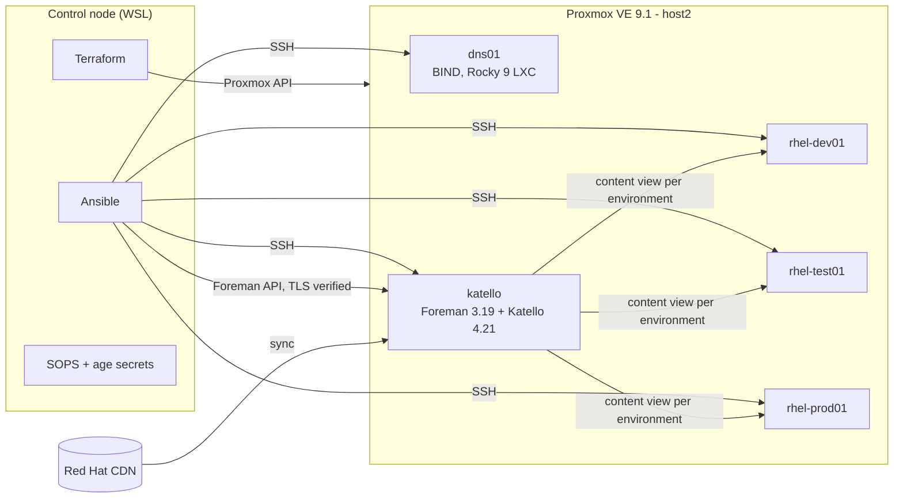
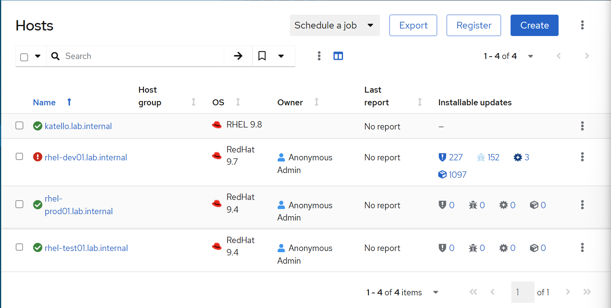
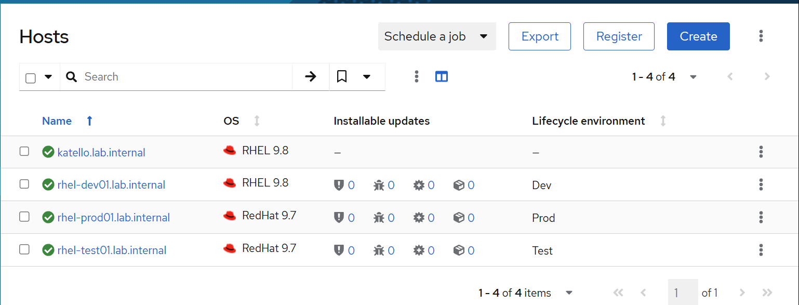
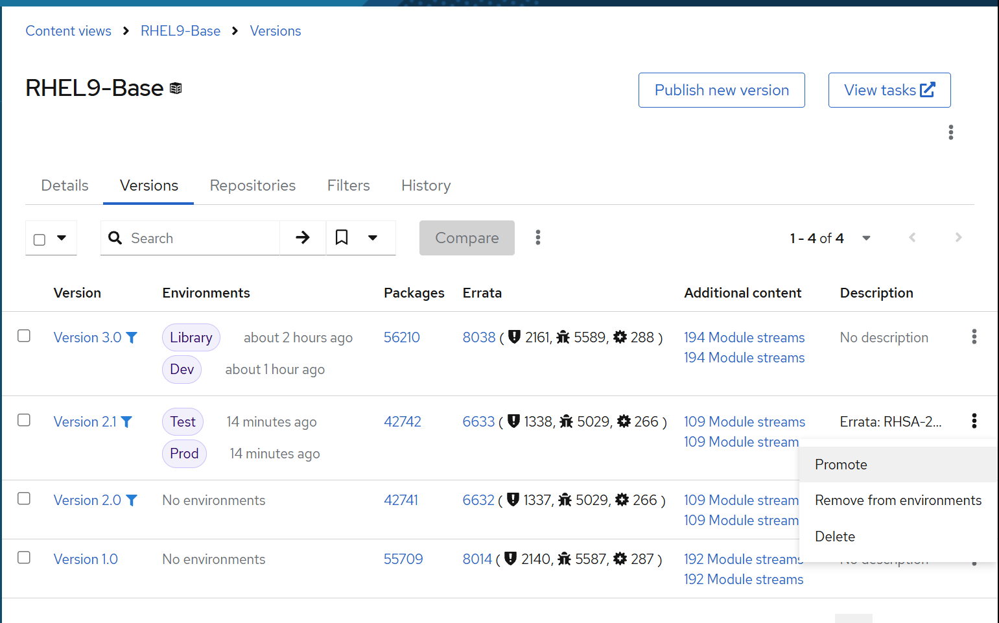
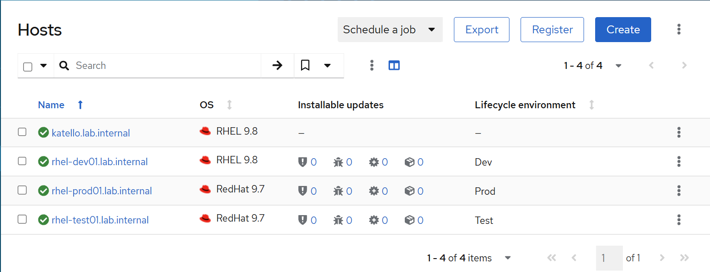
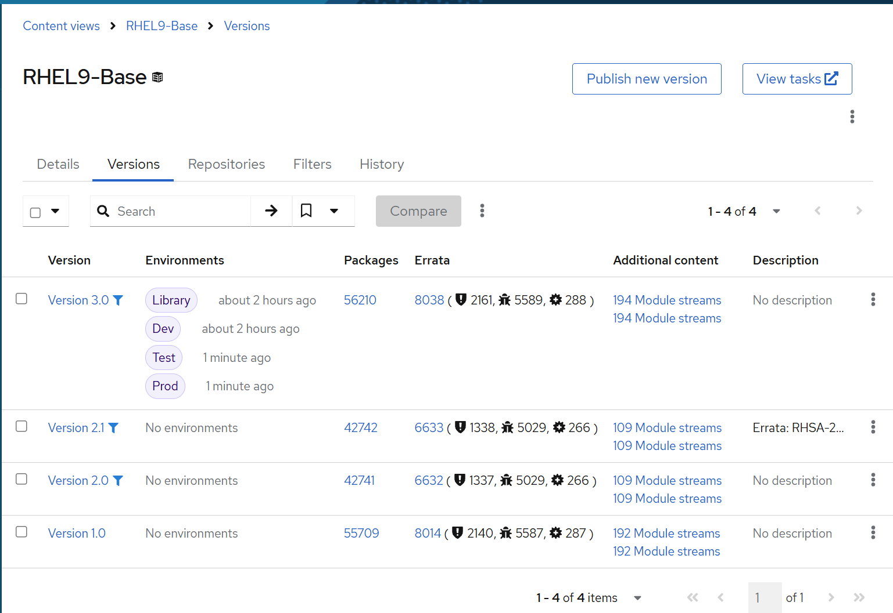
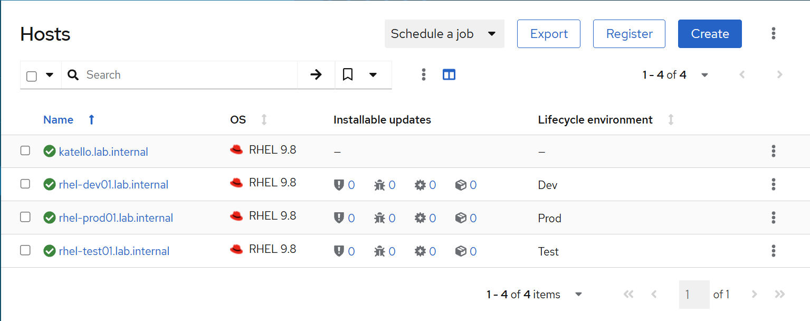
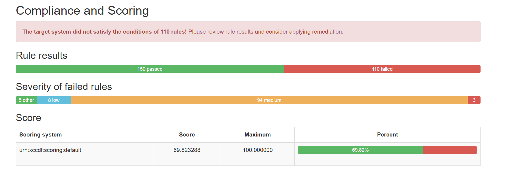
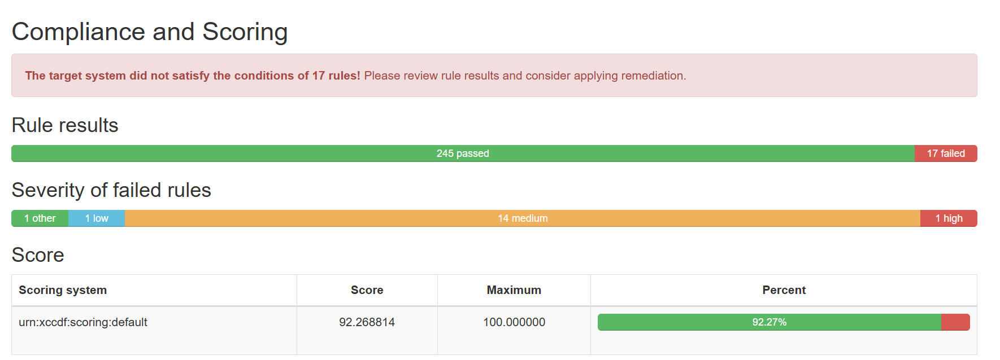

# RHEL Patch Management & Compliance Lab

An enterprise-style RHEL operations environment built entirely as code: **Red Hat Satellite-equivalent patch governance** (Foreman + Katello) and **CIS Level 1 hardening** with OpenSCAP evidence, running on a 2-node Proxmox homelab.

| Result | |
|---|---|
| CIS RHEL 9 Level 1 Server score | **69.82% → 92.27%** on all hosts (110 → 17 failed rules) |
| Remaining findings | **17**, every one documented in an [exceptions register](docs/exceptions.md) |
| Patch governance | Staged Dev → Test → Prod promotion, plus a single-CVE emergency hotfix |
| Reproducibility | Clients destroyed and rebuilt from Git to the identical score in **23 minutes** |

---

## Architecture



| Host | Role | IP | Specs |
|---|---|---|---|
| dns01 | Authoritative DNS for `lab.internal` (forward + reverse) | 192.168.68.20 | 1 vCPU, 512 MB, LXC |
| katello | Content/patch server (upstream of Red Hat Satellite) | 192.168.68.21 | 4 vCPU, 16 GB, 40 GB + 60 GB Pulp LV |
| rhel-dev01 / test01 / prod01 | RHEL 9 clients, one per lifecycle stage | .31 / .32 / .33 | 2 vCPU, 1.5 GB, 20 GB |

---

## What it demonstrates

| Enterprise duty | How it's implemented here |
|---|---|
| **Satellite lifecycle management** | Katello syncs RHEL 9 BaseOS/AppStream (on-demand) into Library; content view versions are promoted through Dev → Test → Prod; hosts register with an activation key per environment |
| **Patch governance** | Content views frozen by errata date; new patch cycles promoted stage by stage; hosts only see content approved for their stage |
| **Emergency CVE response** | Content view incremental update: one errata (RHSA-2026:0067) added to the running baseline (2.0 → 2.1) and promoted to Test and Prod without releasing the rest of the pending cycle |
| **Controlled patching** | `patch.yml`: one host at a time, reboot only when `needs-restarting -r` requires it, verifies running kernel, critical services, and zero remaining errata |
| **CIS hardening** | Curated Ansible role (SSH, kernel/network, PAM/authselect, firewalld, journald, cron, AIDE), rolled out Dev-first |
| **Compliance evidence** | OpenSCAP scans against the SSG CIS Level 1 Server profile; HTML reports committed for every host, before and after |
| **Risk management** | Every unremediated finding has a decision, reason, and compensating control in [`docs/exceptions.md`](docs/exceptions.md) |
| **Infrastructure as code** | Terraform for VMs and the LXC, Ansible for all configuration, secrets encrypted in Git with SOPS + age |

---

## Patch governance walkthrough

**1. New patch cycle reaches Dev only.** Dev's content view is updated; Test and Prod stay on the approved baseline.


**2. Dev patched and validated.**


**3. Emergency hotfix.** Version 2.1 = 2.0 + exactly one errata and one package, promoted to Test and Prod.



**4. Full cycle promoted to Test, then Prod.**



Text records of each stage: [`reports/cv-versions-after-hotfix.txt`](reports/cv-versions-after-hotfix.txt), [`reports/cv-versions-final.txt`](reports/cv-versions-final.txt).

---

## Compliance results

| Host | Baseline | Remediated | Rebuild test |
|---|---|---|---|
| rhel-dev01 | 69.82% | 92.27% | 92.27% |
| rhel-test01 | 69.82% | 92.27% | 92.27% |
| rhel-prod01 | 69.82% | 92.27% | 92.27% |

| Baseline | Remediated |
|---|---|
|  |  |

Full reports: [`reports/baseline/`](reports/baseline), [`reports/remediated/`](reports/remediated), [`reports/rebuild/`](reports/rebuild).

---

## Repository layout

```
terraform/              Proxmox VMs + LXC (bpg/proxmox), encrypted API token
ansible/
  site.yml              full build in order
  inventory/            hosts, group vars per environment, SOPS-encrypted secrets
  roles/
    bind_dns/           forward + reverse zones generated from one host list
    katello_install/    FQDN, swap, LVM for Pulp, RHSM, foreman-installer
    katello_content/    manifest, repos, sync plan, lifecycle envs, content view + filters, activation keys
    rhel_client/        Katello CA, registration by environment, package profile upload
    cis_hardening/      curated CIS Level 1 controls
  playbooks/
    sync.yml            pull content from the Red Hat CDN
    promote.yml         publish/promote a content view version  (-e cv_version=X -e cv_envs=[...])
    hotfix.yml          incremental update: one errata to selected environments
    patch.yml           serial patching with conditional reboot and verification
    harden.yml          apply CIS role, then prove SSH and repo access still work
    scan.yml            OpenSCAP CIS scan, fetch reports  (-e scan_phase=baseline|remediated|rebuild)
reports/                scan reports, score summaries, content view version records
docs/                   architecture, exceptions register, runbook, screenshots
```

---

## How to run

**Prerequisites:** Proxmox VE with an API token, RHEL 9 and Rocky 9 templates, a Red Hat Developer Subscription (manifest + activation key), and a control node with Terraform, Ansible, SOPS, and age.

```bash
# 1. Infrastructure
cd terraform && terraform init && terraform apply

# 2. Everything else: DNS, Katello, content, clients, patching, hardening, scan
cd ../ansible
ansible-galaxy collection install -r requirements.yml
ansible-playbook site.yml

# Day-2 operations
ansible-playbook playbooks/promote.yml -e cv_version=3.0 -e '{"cv_envs": ["Dev"]}'
ansible-playbook playbooks/patch.yml -l dev
ansible-playbook playbooks/hotfix.yml -e errata_id=RHSA-XXXX:XXXX -e base_version=2.0 -e target_envs=Test,Prod
ansible-playbook playbooks/scan.yml -e scan_phase=remediated
```

---

## Design decisions

- **Configuration vs. operations.** `content.yml` defines state and is safe to re-run; promotions and hotfixes are deliberate change events with explicit inputs. Mixed together, a re-run could roll Prod back.
- **Installable-based errata status.** Host health reflects patches *approved* for its environment, not everything Red Hat has published; otherwise Prod is permanently red and alerts get ignored.
- **Curated hardening over generated remediation.** Every control is readable and defensible; generated playbooks include controls that would lock out automation.
- **TLS verified against Katello's own CA,** fetched over SSH so the trust anchor arrives through an authenticated channel.
- **Least privilege.** Terraform uses a dedicated Proxmox API user and role; secrets are encrypted at rest in Git.

## Lessons learned

- Cloud images are minimal: `lvm2` and `sshd` were missing. Assume nothing.
- The Katello installer's real error (20 GB tuning check) printed to the terminal, not the log, and `no_log` hid it. Fixed with `--tuning development` and by keeping secrets off command lines.
- A blanket `dnf update` on a content server is dangerous; OS patching on Katello is limited to the initial build.
- Fresh clients from the newest image showed zero errata. Real fleets lag, so clients were rebuilt from RHEL 9.4.
- A module compared date strings in a different format than the API returned, which caused false `changed` results. Diagnosed by comparing desired vs. actual state with `hammer`.
- A play-level `connection: local` silently overrides `delegate_to`.

## Next steps

- Packer-built golden images (separate /tmp partition from the start)
- Clear the three backlog items in the exceptions register
- Foreman remote execution to trigger patching from Katello itself
- Prometheus alerting on the Proxmox thin pool

---

**Author:** Nicolai Matthew · RHCSA · [\[LinkedIn URL\]](https://lnkd.in/p/giRTe7kk)
